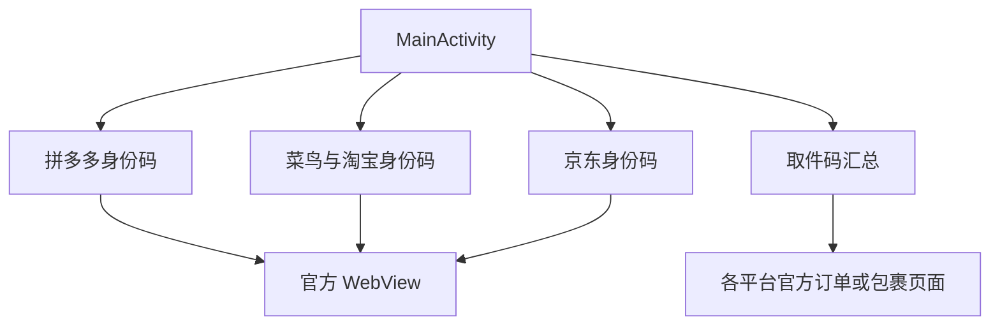

# HandyCode

<p align="center"></p>

HandyCode 是一个 Android 取件工具。底栏可打开拼多多、菜鸟｜淘宝和京东的官方身份码，最右侧「取件码」汇总淘宝、拼多多、京东、顺丰和抖音官方页面提供的待取件信息。

HandyCode brings official identity codes and pending parcel pickup information into one Android app. It is an unofficial client.

当前版本为 **0.8.54**，支持 Android 8.0（API 26）及以上，目标 API 35。

- [下载 HandyCode v0.8.54](https://github.com/l-egend/handycode/releases/tag/v0.8.54)
- [查看此 fork 的全部版本](https://github.com/l-egend/handycode/releases)
- [版本、包大小及签名证书摘要](release.json)

安装包随 GitHub Releases 分发，仓库不跟踪构建产物。下载站是独立项目，不随本仓库发布。

## 维护与联系

本仓库由 [l-egend](https://github.com/l-egend) 维护，fork 自 [原 HandyCode 项目](https://github.com/xianhe51920/handycode)。


## 免责声明

本项目为非官方客户端，与所接入平台及其所属公司无关联，也未获其授权或认可。

应用在本机系统 WebView 中加载各平台的官方页面。使用前请自行确认是否符合你所在地区的法律及各平台服务条款。因使用本应用产生的账号风险、风控或数据问题由使用者自行承担。

## 使用方式

1. 底栏从左到右是「拼多多」「菜鸟｜淘宝」「京东」「取件码」。点底栏或在内容区横向拖动切换页面。
2. 前三个入口可打开身份码。进入「菜鸟｜淘宝」后，可点顶部的平台标题切换菜鸟和淘宝。
3. 「取件码」汇总官方页面提供的待取包裹。点「登录与查件」里的平台进入登录、订单或查件页面，返回汇总后可点「刷新全部」重新同步。
4. 首次使用时请在对应平台完成登录及验证。右上角显示登录状态，身份码卡片提供刷新。
5. 拼多多登录页的“打开拼多多APP”可直接打开官方 App 的身份码页；系统未能处理时保留官方网页备用入口。
6. 应用会记住上次停留的平台，重新打开时直接回到该平台；从桌面快捷方式进入时，以快捷方式指定的平台为准。

## 隐私与登录

各平台的登录和验证由对应官方服务处理。Android 的 WebView 在本机保留页面数据和登录 Cookie。

- 应用只申请网络权限（`android.permission.INTERNET`）。
- 应用在本机读取登录状态，部分平台的会话信息保存在应用本地存储中，用于恢复登录。
- 取件码、包裹摘要及页面偏好可能缓存在手机上。身份码显示的是官方页面生成的内容。
- 项目没有自建账号服务器、统计 SDK 或崩溃上报服务，应用禁用 Android 系统备份。

卸载应用或清除应用数据后，需要在官方页面重新登录。

## 整体结构

原生 Java 负责页面容器、手势、动画、登录状态提示和 WebView 生命周期；HTML / JavaScript 负责将官方页面内容投影成统一布局。项目没有自建账号服务器或业务 API 服务。



## 淘宝实现原理

- `MainActivity` 先加载固定官方身份码入口。`official-identity.js` 检查实际码内容、登录输入控件及跨域认证 iframe；只有官方页面已能显示有效内容，才切入合并布局，避免用空壳覆盖登录页。
- `taobao.html` 保留身份码和包裹的官方来源 iframe，读取可访问的内容。待取包裹汇总到「取件码」，也可从那里打开菜鸟包裹页或淘宝订单物流。
- `refresh-controller.js` 将主动刷新和来源 iframe 的被动 `load` / DOM 更新分开。主动刷新只让对应卡片进入加载状态，重复点击合并；相同可见内容保留节点、更新事件引用，避免“刷新 / 刷新中”与骨架反复闪烁。
- 原始身份码未生成时，仅在非登录状态下有界触发官方刷新控件；输入手机号、验证码或显示认证 iframe 时暂停，不自行提交表单。
- `taobao-login-chrome.js` 只隐藏“您需要登录才能继续访问 / 关闭”这一外层标题，回收 iframe 顶部占位。官方 iframe 的节点和 `src` 不变，输入与验证流程继续由官方处理。

## 拼多多：网页跳转与登录问题如何解决

完整细节见 [拼多多 H5 实现说明](docs/pdd-html-investigation.md)。

### 1. 为什么原链接登录后又回登录页

入口是 `https://m.pinduoduo.net/mdkd/package?tab=ID_CODE`。排查时发现：身份码页的浏览器业务请求发往 `https://api.pinduoduo.com/api/...`，而普通网页登录使用当前官方站点已有的 `/proxy/api/` 路由。

`.net` 页面与 `.com` API 属于跨站访问，Cookie 的作用域、SameSite 及浏览器跨站规则都会影响会话是否被服务端接受。曾观察到页面短暂显示框架、前置检查报告未登录，随后回到登录页。单独一条 `api_uid` 的 SameSite 警告不能证明它就是登录凭据，也不能说明所有跳转都由它造成。

### 2. 保留官方逻辑，将请求接回官方同源路由

`PddPage` 只拦截严格匹配的官方公开 CDN `_app-<hash>.js`，正常 HTTPS 下载后，在前面加入兼容脚本。`pdd-same-origin.js` 在原应用脚本执行前包装 `XMLHttpRequest.open` 和 `fetch`，只映射指定来源：

```text
https://api.pinduoduo.com/api/express_trackbox/...
                         ↓
https://m.pinduoduo.net/proxy/api/api/express_trackbox/...
```

这里的 **`/proxy/api/api/` 两段 `api` 是有意保留的**：官方代理前缀为 `/proxy/api`，原 API 路径仍以 `/api/` 开头。

脚本保留原方法、请求体、请求头、查询参数与调用选项。`Request` 输入按原对象重建。拼多多的请求仍由 WebView 按官方站点规则管理认证。登录页和验证页不应用这段 API 映射。

### 3. 控制跳转，而不是无限重登

- WebView 内部只允许 `https://m.pinduoduo.net` 的正常 HTTPS 导航，阻止其他域名和任意协议接管页面。
- 官方登录验证偶尔会落到 `/index.html`，丢失身份码返回目标。应用在确实经过登录后，**最多自动返回身份码入口一次**；仍失败则保留官方页面，避免强制重定向循环。
- 登录页“打开拼多多APP”是另一条手动路径：仅在当前官方登录页、主框架、有用户手势且目标精确匹配时，由原生显式交给 `com.xunmeng.pinduoduo`：

  ```text
  pinduoduo://com.xunmeng.pinduoduo/mdkd/package?tab=ID_CODE
  ```

  这条路径调用原来已验证的身份码深链，安装有拼多多时直接交给该 App。它与 H5 登录保持相互独立，不会把 App 的登录凭据复制到 WebView。未加入微信网页入口。

### 4. 为什么登录状态能保留

- 启用 WebView 的 Cookie 和 DOM Storage，复用同一应用的默认 WebView 数据目录，不在启动、切页、退出 Activity 或覆盖更新时清空它。
- 页面完成和应用进入后台时执行 `CookieManager.flush()`，让 Cookie 存储及时落盘；`localStorage` 等仍由浏览器按来源管理。拼多多不依赖放开第三方 Cookie，而使用上述第一方官方代理。
- 拼多多页面首次打开后保留 WebView 与当前文档，以便返回时继续使用。
- Release 沿用相同包名与签名，使用 `adb install -r` 覆盖安装，继续使用原沙箱数据。

`flush()` 不会延长官方 Cookie 的过期时间，也不会把会话 Cookie 变成永久凭据。卸载、清除应用数据、主动退出、服务端会话失效或风控要求重新验证时，仍需要登录；电脑浏览器和官方 App 的会话也不会自动同步给本应用。

## 拼多多身份码与待取包裹

### 同一文档投影，保持官方 React 活着

`pdd-layout.js` 保留原始 `#__next` 根节点，并将官方内容投影到 `#hc-pdd-shell`。「拼多多」标签显示身份码，待取包裹从最右侧「取件码」进入。

身份码复用官方生成的图片或 SVG，仅撤销展示布局中的旋转，使其横向、居中；不会解码或重新生成条码。待取区只投影当前待取列表或空状态，隐藏推荐商品、已取记录和原始底栏。需要绑定手机号等表单时，临时显示原官方流程并提供返回入口。

### 每张卡片只刷新自己

`PddBundleAdapter` 对两个固定公开组件脚本（`1235-<hash>.js`、`8905-<hash>.js`）进行唯一锚点匹配，在组件生命周期内注册其现成的身份码与包裹查询回调。响应处理只报告成功布尔值，不把业务数据交给原生层。

`pdd-section-refresh.js` 按分区去重，允许两个分区并行，12 秒超时；`pdd-layout.js` 固定所点卡片高度、隐藏旧显示、等待官方状态更新后替换这一块，另一块 DOM 不变。失败只在当前卡片显示重试。上游脚本结构不匹配时不勉强替换、不误绑回调，也不退回整页刷新。

### 避免原页闪现和永久骨架

- 原生 `PddLoadingView` 先遮住未整理的原页；合并壳及源标记存在后，读取少量几何数字，并等待 `postVisualStateCallback` 确认绘制，再淡出。
- 脚本执行早于 `#__next` 挂载时，等待根节点出现；即使超过提示时间，也允许晚到节点继续初始化。
- 除提交回调外，文档完成回调也能启动交接；遮罩期间每 500ms 检查就绪，最多 60 次。已准备好但缺少新 console 阶段时仍可恢复。不会因此自动重载网页或重复业务请求。
- 内容默认不透明，短暂入场效果在隐藏时取消。已访问页保持附着，避免返回时只剩有标题的空白卡片。

## 原生交互与退出登录

`SwitchMotion` 用一个 0—1 进度同时驱动中间页面横移、顶部图标标题纵向切换和底部选中背景移动。松手时按半屏距离判断；速度达到 600dp/s 且移动至少 24dp 时支持短距离快滑。`SwipeFrameLayout` 区分横向意图和竖向滚动，取消时回到已选平台；未访问页预览只有静态骨架，落定后才创建并加载 WebView。

键盘打开时缩减网页可用区域，并暂时隐藏底栏。登录状态提示由官方页面或网页会话状态更新。

退出时关闭当前平台旧网页，再用 AndroidX WebKit 的按站点删除能力清理其 Cookie、JS 存储和缓存，完成后打开登录入口。淘宝范围为项目允许的五个登录站点，拼多多为 `pinduoduo.net`。不会调用全局 Cookie / WebStorage 清理来退出单个平台。WebView 不支持该能力时提示更新。

## 构建 Release

构建已使用 JDK 21、Android SDK Platform 35 和 Build Tools 36.0.0 验证。独立构建使用 `aapt2 → javac → D8 → zipalign → apksigner`。

```powershell
.\build-android.ps1 -Configuration Debug -AndroidSdk 'D:\path\to\SDK' -JavaHome 'D:\path\to\JDK'
```

已有签名密钥时可用 `-Configuration Release` 生成发行包。Release 显式设置 `android:debuggable="false"`。产物写入 `dist/`，发行构建同时生成 SHA-256 校验与 `release.json`。运行完整本地回归套件时还需要 Node.js 和测试依赖。

**签名延续原调试期证书**，用于兼容已有安装；本机密钥仍位于 `.local/debug.keystore`，不进入 Git 或 APK。Release 构建在缺少该密钥时会停止，避免悄悄生成另一把密钥。应用商店发布需另行规划生产签名与迁移。

AndroidX WebKit 精简库随仓库提供并在构建前校验 SHA256；其来源、Apache 许可和离线重建方式见 [依赖说明](third_party/androidx-webkit-1.13.0/README.md)。

## 应用图标

图标采用奶油色圆角底板、深红描边与角色抱快递箱的设计。源图位于 `design/icon-candidates/icon-02.png`。

采用 Android 自适应图标：`mipmap-anydpi-v26/ic_launcher.xml` 组合背景色 `#FCF6E7` 与前景位图，前景用 `<inset>` 内缩 13%。这个比例是按「底板描边正好落在 72dp 可见视口边缘」算出来的，使深红描边贴住图标边界；背景与底板同色，遮罩裁切不会露出接缝。

一套资源即可适配所有密度与桌面图标尺寸，不需要多套 `mipmap-*dpi`。但遮罩形状由桌面决定，红框只能对齐圆角方形遮罩，圆形遮罩桌面上四角描边会被裁掉一部分。换算方式、重新生成步骤和验收记录见 [应用图标原理](docs/launcher-icon.md)。

## 检查与已知边界

构建会检查 DEX、对齐、签名与包信息。包含完整本地测试套件的工作目录还会运行回归检查。真机安装与无线调试见 [无线调试说明](docs/wireless-debugging.md)，逐版本验证记录见 [内嵌网页版本验证记录](docs/webview-validation.md)。

0.8.54 已在 Android 模拟器上验证标准屏、窄屏、京东身份码页面和京东订单取件码汇总。京东登录和订单检查使用模拟数据，真实账号与待取包裹仍需实机验证。较早版本的实机记录见上方链接。

曾出现拼多多偶发长时间加载、随后自行恢复；已修复可复现的晚挂载缺口并补充遮罩恢复，但当时完整状态未捕获，不能保证排除所有网络或上游变更因素。H5 和公开脚本结构受平台更新影响，适配不匹配时会停止对应操作并提示重试。

## 主要文件

| 文件 | 职责 |
| --- | --- |
| `MainActivity.java` | 原生容器、淘宝集成、标题与底栏、键盘和生命周期 |
| `PddPage.java` | 拼多多 WebView、公开脚本适配、登录返回及绘制交接 |
| `CainiaoPage.java` | 菜鸟身份码 |
| `JdIdentityCard.java` | 京东身份码、刷新和登录页面 |
| `JdPage.java` | 各平台登录、查件和取件码汇总 |
| `UrlPolicy.java` | 官方 HTTPS 导航、公开脚本及固定深链范围 |
| `SwitchMotion.java` / `SwipeFrameLayout.java` | 联动进度、拖动识别与落定规则 |
| `SiteDataClearer.java` / `LogoutSites.java` | 当前平台按站点退出 |
| `assets/taobao.html` | 淘宝双来源投影与卡片布局 |
| `assets/pdd-same-origin.js` | 官方同源 API 路由映射 |
| `assets/pdd-layout.js` | 拼多多投影、表单返回及加载恢复 |
| `PddBundleAdapter.java` / `assets/pdd-section-refresh.js` | 官方组件回调与独立刷新协调 |

Java 文件均位于 `app/src/main/java/com/fairycrane/handycode/`，网页资源位于 `app/src/main/assets/`。

## 许可

源码以 [MIT 许可](LICENSE) 发布。随仓库提供的 AndroidX WebKit 精简库为 Apache License 2.0，来源与许可文本见 [third_party/androidx-webkit-1.13.0](third_party/androidx-webkit-1.13.0/README.md)。

应用图标由作者提供的参考图生成，仅作本项目标识使用；若其中涉及第三方角色形象，其权利归原权利人，MIT 许可不涵盖该图形。


## 京东身份码与取件码

底栏「京东」直接显示官方身份码。在该页登录并显示身份码后，应用会尝试同步同账号的京东商城订单。

最右侧「取件码」中的京东入口提供京东商城订单、京东快递订单和按运单号查物流。京东快递收件记录使用独立的官方登录入口。商城订单或快递收件页提供可识别的取件码时，软件会将其汇总。只返回到站状态的京东商城包裹会显示「已到站」。

## 扫码亮度

拼多多、菜鸟、淘宝和京东的身份码显示时，可临时提高本应用窗口亮度。切换页面、打开弹窗或应用失去焦点后恢复先前亮度。

底栏标题使用单层固定坐标绘制，选中颜色随滑动进度过渡，玻璃背景独立动画。
